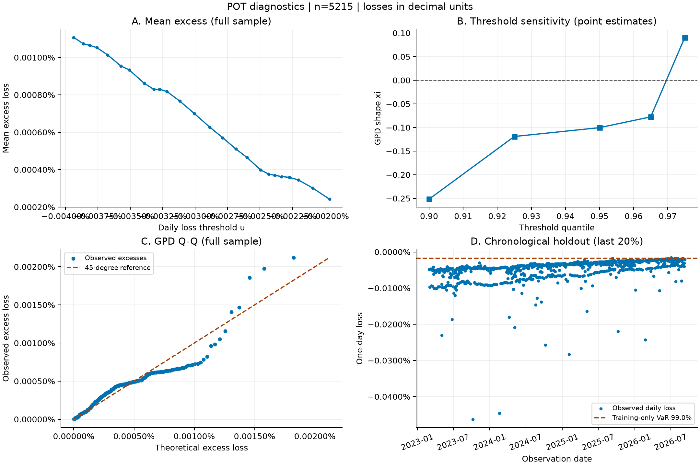

# 单基金 POT 极值风险结果

状态：`estimated_requires_diagnostic_review`

所有收益、损失、VaR、ES 均为小数：0.03 表示 3%。持有期限为一个观测交易日。

数据：2009-01-04 至 2026-09-10，5215 条日收益。

最低要求：1000条有效日收益及三年日期跨度，另检查日频和长缺口。

阈值分位 95.0%，阈值损失 -0.002299%；
超阈值 261 条，实际比例 5.0048%；xi=-0.100276，beta=3.92279e-06。

| 置信水平 | 单日损失 VaR | 单日损失 ES |
| --- | --- | --- |
| 99.00% | -0.001715% | -0.001412% |

注意：损失阈值不为正，尾部含上涨或零收益日；不能据此声称已观察到极端下跌。

## 样本外检验

- 99.00% VaR：测试期 1043 天，超越 1 天（0.10%），二项检验 p=0.0008071；最长连续超越 1 天。

二项检验未拒绝不代表模型已获验证；应结合聚集情况、阈值敏感性和置信区间判断。

全样本拟合描述截至数据末日的尾部风险；样本外检验独立使用前80%训练参数。
参数、VaR、ES 的95%循环块Bootstrap区间及失败次数详见 result.json。

图中数据及变换可从 result.json 和 daily_returns.csv 复核；阈值敏感性图为点估计，无置信带。

## 解释边界

- 日度VaR/ES不是月度累计收益或最大回撤，也不是最大可能亏损。
- 全样本拟合使用所有已知历史，不能冒充各历史时点的预测；样本外检验仅使用训练期拟合参数。
- 不填补日期缺口，不调整分红或拆分；累计净值不一定是分红再投资总回报，应核对数据口径。
- GPD是高阈值渐近近似；阈值、极值数量、结构变化及时间依赖会影响可靠性；拟合成功不是模型通过验证。
- Bootstrap采用固定20条观测的循环块（可用参数调整），置信区间仍是近似；二项检验未校正时间依赖。
- 原始收益包含上涨日对应的负损失；负VaR/ES不截零，不代表产品没有未来下跌风险。
- GPD外推可能超过单日100%损失的经济边界；此时报告异常标志而不截断或强行解释。
- 货币基金若仅提供每万份收益，按收益/10000处理，假设当日收益可再投资；不对每万份收益做涨跌幅。
- 单基金VaR不能直接相加或按权重求和得到组合VaR。

## 方法来源

实现依据：用户提供的《极值理论-POT方法.md》。
[SciPy GPD](https://docs.scipy.org/doc/scipy/reference/generated/scipy.stats.genpareto.html)；
[SciPy 二项检验](https://docs.scipy.org/doc/scipy/reference/generated/scipy.stats.binomtest.html)。
